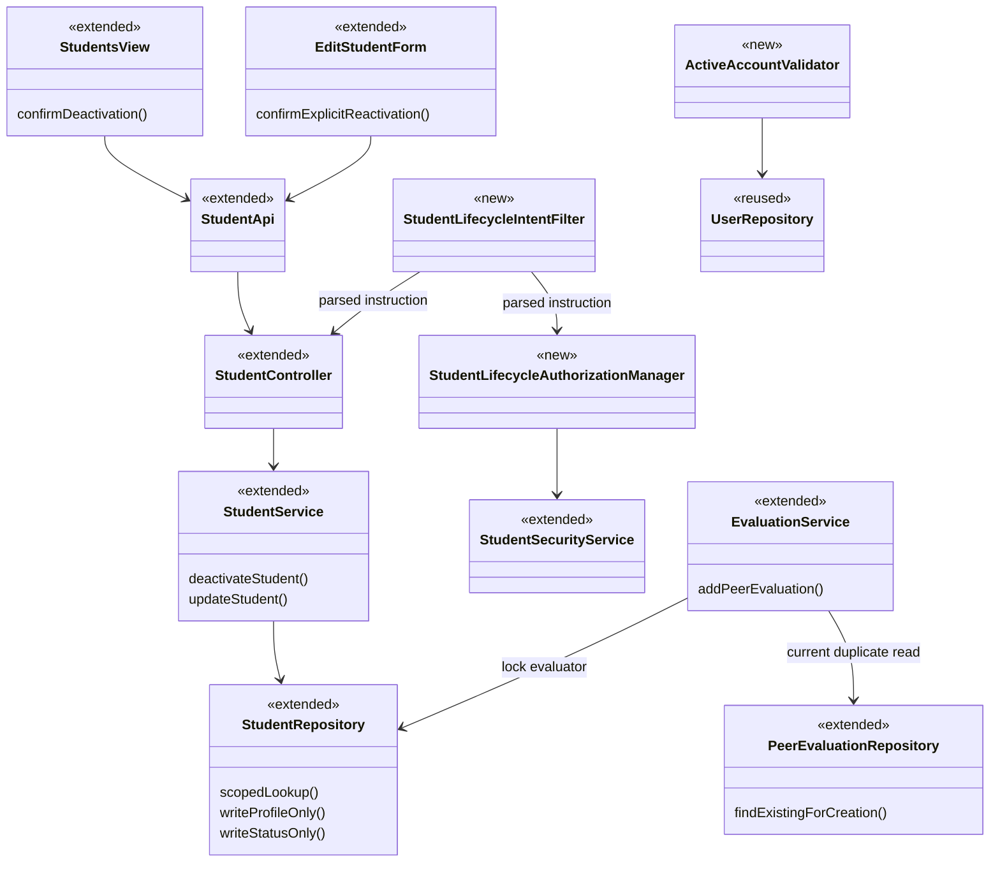
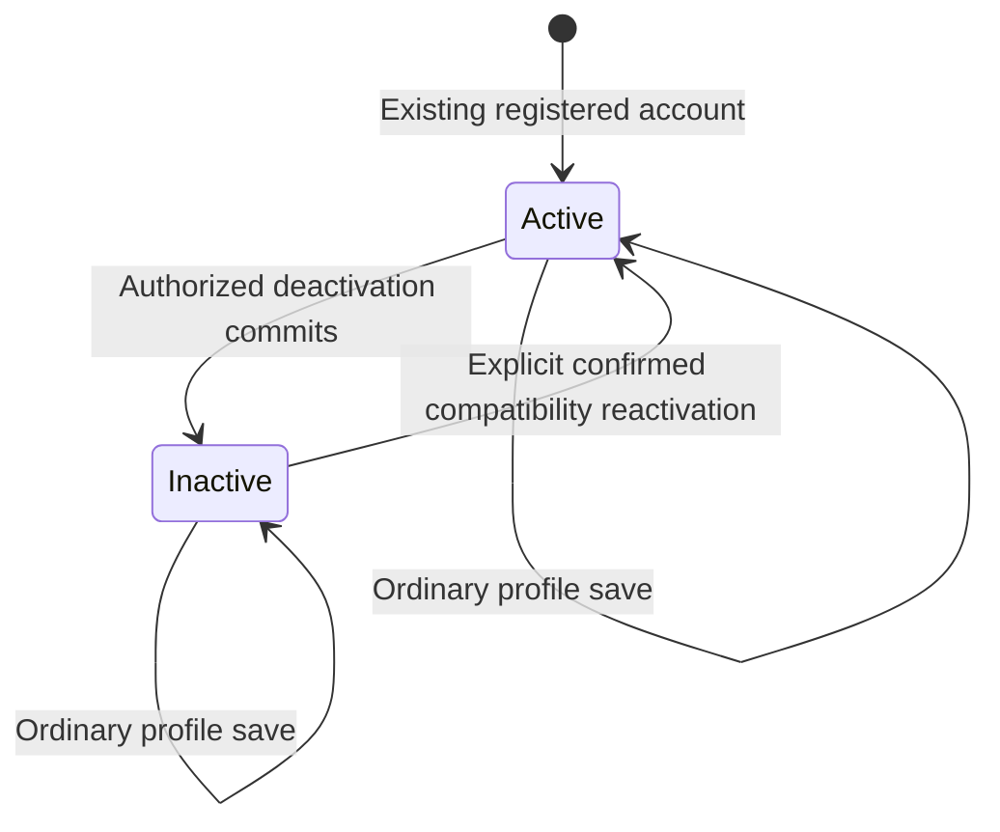

# Student Design

> Realizes: [UC-STU-deactivate-student](../requirements/use-cases.md#uc-stu-deactivate-student-the-course-admininstructor-deactivates-a-student)
> Depends on FRs: FR-SEC-authentication, FR-SEC-authorization, FR-SEC-deny-unauthorized, FR-SEC-active-account ([SRS](../requirements/software-requirements-specification.md#security-and-authorization-requirements))
> Supporting change: [UC-EVA-submit-evaluation](../requirements/use-cases.md#uc-eva-submit-evaluation-the-student-submits-a-peer-evaluation-for-the-previous-week); compatibility only for UC-STU-reactivate-student.
> Review state: design PR #2 merged; the developer additionally approved serialized evaluation creation with a duplicate recheck during implementation. Implementation and feature verification are recorded in [the build evidence](../guides/uc-stu-deactivate-student-verification.md); unrelated baseline checks remain separately identified.

## Overview

Extend the existing student vertical slice inside the [platform containers](architectural-design.md#containers), following [Architectural conventions](architectural-design.md#architectural-conventions). Requirements remain in the linked use cases and [business rules](../requirements/business-rules.md). The deactivation operation and profile operation have disjoint persistence write sets. Shared JWT validation enforces account status across performance tracking and RAM. Reactivation remains on the existing update endpoint as compatibility maintenance; this design does not complete its separate use case or add its notification workflow.

## Components & classes

Paths below are relative to the repository root. The linked paths and named new classes are implemented in the build branch.

| Component | Reuse / change | Responsibility and file |
|---|---|---|
| Student Management | Extend [Students.vue](../../frontend/src/pages/students/Students.vue) | Deactivate action, student identity/details, warning, confirmation, pending state, refresh after success |
| Profile form | Extend [EditStudentForm.vue](../../frontend/src/pages/students/EditStudentForm.vue) | Read-only status; separate Save changes and reactivate control for inactive students; ordinary save never sends reactivation intent |
| Student API | Extend [index.ts](../../frontend/src/apis/student/index.ts), [types.ts](../../frontend/src/apis/student/types.ts) | Dedicated deactivate call; explicit optional reactivation parameter on existing update call |
| Student controller / service | Extend [StudentController.java](../../backend/src/main/java/team/projectpulse/student/StudentController.java), [StudentService.java](../../backend/src/main/java/team/projectpulse/student/StudentService.java) | Deactivate endpoint; transaction boundaries; same-student lifecycle row locking; atomic profile-save and compatibility reactivation |
| Student persistence | Extend [StudentRepository.java](../../backend/src/main/java/team/projectpulse/student/StudentRepository.java) | Caller-scoped lookup and mutation predicates; lifecycle row lock; targeted status/profile writes; refresh DTO from current state |
| Lifecycle permission | Extend [StudentSecurityService.java](../../backend/src/main/java/team/projectpulse/student/StudentSecurityService.java); new `backend/src/main/java/team/projectpulse/security/authorizationmanagers/StudentLifecycleAuthorizationManager.java` | Course ownership or assigned course-section instructor, with direct or inherited instructor authority; fail closed |
| Lifecycle intent parser | New `backend/src/main/java/team/projectpulse/security/StudentLifecycleIntentFilter.java` | Parse the strict optional query once after authentication, store the instruction on the request, map malformed input outside the guard |
| JWT account check | New `backend/src/main/java/team/projectpulse/security/ActiveAccountValidator.java`; extend [SecurityConfiguration.java](../../backend/src/main/java/team/projectpulse/security/SecurityConfiguration.java) | Compose current-account validation with existing JWT validation; strict identity validation; 503 mapping for account-store failure; register deactivation and intent-aware PUT rules |
| Shared error mapping | Extend [StatusCode.java](../../backend/src/main/java/team/projectpulse/system/StatusCode.java), [ExceptionHandlerAdvice.java](../../backend/src/main/java/team/projectpulse/system/exception/ExceptionHandlerAdvice.java) and [CustomBearerTokenAuthenticationEntryPoint.java](../../backend/src/main/java/team/projectpulse/security/CustomBearerTokenAuthenticationEntryPoint.java) as needed | SERVICE_UNAVAILABLE/503 Result for account-store failure, with a generic message and no internal exception details |
| Shared identity | Reuse [UserRepository.java](../../backend/src/main/java/team/projectpulse/user/UserRepository.java), [MyUserPrincipal.java](../../backend/src/main/java/team/projectpulse/user/MyUserPrincipal.java) | Current enabled-state lookup for students and instructors; existing login enabled check |
| Evaluation submission | Extend [EvaluationService.java](../../backend/src/main/java/team/projectpulse/evaluation/EvaluationService.java), [SubmitTeamsEvaluations.vue](../../frontend/src/pages/evaluations/SubmitTeamsEvaluations.vue) | Creation-only active-recipient check; immutable evaluator/recipient/week on updates; per-row draft and saved outcomes during stale-form recovery |
| Infrastructure | Reuse [request.ts](../../frontend/src/utils/request.ts), [SubmissionStatusService.java](../../backend/src/main/java/team/projectpulse/notification/SubmissionStatusService.java) | Existing error/logout handling and active-only submission obligations |



## Sequence

### Deactivation

```mermaid
sequenceDiagram
    actor Operator as Course admin / assigned instructor
    participant UI as Student Management
    participant API as Student API and route guard
    participant Service as StudentService
    participant DB as StudentRepository
    Operator->>UI: Steps 1-3: view details and choose Deactivate
    UI->>API: Step 2: GET student details (existing view flow)
    API-->>UI: Student identity, status, enrollment and team
    UI-->>Operator: Step 4: consequences, Cancel and Deactivate student
    alt Extension 5a: cancel
        Operator->>UI: Cancel
        Note over UI,DB: No mutation request
    else Step 5: confirm
        Operator->>UI: Confirm
        UI->>API: POST /students/{studentId}/deactivate
        API->>API: Authenticate and check lifecycle permission
        alt Extension 1a or 3a: refused
            API-->>UI: 401 or 403 Result, no changes
        else Authorized
            API->>Service: Step 6: deactivate
            Service->>DB: Resolve target inside caller's current permitted scope and lock lifecycle row
            alt Extension 6b: target disappeared or left caller scope
                Service-->>API: Not found
                API-->>UI: 404 Result
            else Existing target, active or already inactive (6a)
                Service->>DB: Scoped mutation: write enabled=false only, in transaction
                DB-->>Service: Current persisted student
                Service-->>API: Student DTO
                API-->>UI: 200 Result
                UI-->>Operator: Step 6: display returned inactive DTO and success
            end
        end
    end
    Note over UI,DB: Extension 6c: rollback failed writes; lost response permits reload or idempotent retry
    Note over UI,API: Extension 6d: failed follow-up refresh does not undo acknowledged success
```

The warning names the student and explains the consequences cited by the UC. Confirmation is disabled while pending; no optimistic status change or success toast precedes a successful response. Use accessible labels, focus handling and keyboard-operable controls. Existing shared 401/403/404 routing remains in use. Network/server failures retain a retry path; a lost mutation response is an unknown outcome, not evidence of rollback. Once the mutation returns success, apply its DTO and show success before the optional roster refresh. If refresh fails, retain the returned state and show a separate warning: "Student deactivated. The list could not be refreshed; try refreshing again." Do not label the mutation failed or automatically repeat it. A subsequent authorized operation may legitimately change the status again.

### Existing-token refusal and restoration compatibility

```mermaid
sequenceDiagram
    actor User as Student or instructor
    participant API as Protected API
    participant JWT as JWT authentication
    participant DB as UserRepository
    User->>API: Request with existing bearer token
    API->>JWT: Authenticate
    JWT->>JWT: Existing signature/expiry and strict userId validation
    alt Invalid token or malformed identity
        JWT-->>API: Authentication failure, no account lookup
        API-->>User: 401 Result
    else Valid token and identity
        JWT->>DB: Resolve signed userId and current enabled state
        alt Account absent or disabled
            JWT-->>API: Authentication failure
            API-->>User: 401 Result
            Note over User,API: Existing SPA handler clears login state
        else Account store unavailable
            JWT-->>API: Infrastructure authentication failure
            API-->>User: 503 generic Result; no protected business logic
            Note over User,API: SPA retains login and allows retry
        else Account active
            JWT-->>API: Authenticated principal
            API->>API: Existing route and scoped-data authorization
            API-->>User: Existing resource response
        end
    end
    Note over User,DB: After explicit reactivation, an otherwise-valid old token can authenticate again
```

### Profile save and explicit reactivation compatibility

```mermaid
sequenceDiagram
    actor Operator
    participant UI as EditStudentForm
    participant API as Existing student PUT
    participant Service as StudentService
    participant DB as StudentRepository
    alt Ordinary profile save
        Operator->>UI: Confirm profile changes
        UI->>API: PUT /students/{id} without reactivate=true
        API->>Service: Existing profile permission, validated DTO
        Service->>DB: Update profile columns only
    else Separate Reactivate account control
        Operator->>UI: Confirm Save changes and reactivate, including unsaved profile edits
        UI->>API: PUT /students/{id}?reactivate=true with current profile DTO
        API->>Service: Lifecycle permission for explicit restoration
        Service->>DB: Lock lifecycle row; scoped profile and enabled=true writes in one transaction
    end
    Service-->>API: Current Student DTO
    API-->>UI: Result
    Note over API,DB: Unauthorized intent refuses the whole transaction; submitted enabled never controls status
```

## API contract

Paths are relative to `/api/v1`. Success and failure use the existing `Result` envelope and status mapping. No new scheduled job is introduced.

| Endpoint | Caller | Request | Success | Errors, by flow |
|---|---|---|---|---|
| New `POST /students/{studentId}/deactivate` | Target course owner or assigned course-section instructor | Path ID; no body | 200, current Student DTO with inactive status; same result for 6a | 1a: 401; 3a: 403, including unresolved/malformed target at guard; 6b: 404 for missing or newly inaccessible target after authorization; 6c: server failure or transport error, safe retry |
| Changed `GET /students/{studentId}` | Existing self/assigned-instructor viewers plus target course owner | Path ID | Existing Student DTO for confirmation/details | Existing 401/403 refusals; absent target fails closed at guard |
| Changed `PUT /students/{studentId}` | Existing profile authorization for ordinary save; lifecycle authorization for explicit restoration | Existing validated profile DTO; optional query `reactivate`, default false | 200 current Student DTO; absent/false instruction never alters status, regardless of body `enabled` | Existing validation errors 400; unauthenticated/inactive caller 401; explicit unauthorized intent 403 with no profile changes; post-guard disappearance or scope loss 404; transaction failure rolls back |
| Changed `POST /evaluations` | Existing authorized active student | Existing evaluation DTO | Existing success for active recipient | UC-EVA-submit-evaluation 5a: 400 / INVALID_ARGUMENT with inactive-recipient message; all existing refusals retained |
| Existing `PUT /evaluations/{evaluationId}` | Existing authorized evaluator | Existing update DTO | Only ratings/comments change; stored evaluator, recipient and week immutable; inactive recipient alone does not block existing edits | Existing window, validation and ownership errors unchanged |
| Existing `GET /students/teams/{teamId}` | Existing team access | Team ID | Full roster including inactive accounts | Existing errors unchanged; evaluation-entry UI filters new choices locally |

All protected bearer requests additionally honor FR-SEC-active-account (401 for invalid/missing/disabled account, 503 for account-store unavailability); basic login retains its enabled-account check. `reactivate=true` is sent only by the separately confirmed control, never derived from the DTO or a stale status switch. Already-active restoration succeeds. Only absence, one literal `false`, or one literal `true` is accepted for the `reactivate` query parameter. Empty values, duplicates (even identical duplicates), other spellings/casing and all other values return 400 / INVALID_ARGUMENT. Authenticate first (401 takes precedence); parse once before intent-based authorization. Reuse that parsed instruction in the guard and service. Malformed intent never falls back to profile-only saving; handle it explicitly outside the authorization manager rather than throwing from the guard. No new reactivation endpoint is introduced.

## Key decisions

| Decision | Chosen approach | Rejected alternative and reason |
|---|---|---|
| Mutation boundary | Dedicated deactivate operation, write `enabled` only | Full-profile deactivation payload could overwrite unrelated fields |
| Persistence safety | Explicit column-limited writes for profile and status; clear/refresh affected managed state before returning DTO | Merely removing a setter does not guarantee ORM updates cannot write stale status during overlapping transactions |
| Permission | Instructor authority via the server role hierarchy plus target-course ownership or assigned course-section membership; route guard and caller-scoped repository query using `UserUtils` | Global admin role, caller-chosen body scope, or default course-section preference is not authority over the target |
| Compatibility | Existing PUT accepts explicit restoration intent; Save changes and reactivate confirms submitted profile edits plus restoration as one transaction; ordinary DTO status ignored | Removing restoration breaks existing functionality; retaining an ordinary status switch risks accidental restoration; dedicated reactivation endpoint expands the assignment |
| Lifecycle concurrency | Lock the same student row for deactivate and explicit restore; last successful commit in serialized order determines status | Unlocked read/modify/save risks lost status writes; permanent deactivation priority would ignore later deliberate restoration |
| Live account validation | Central JWT validator using signed userId and current persisted state, for students and instructors | UI-only logout, token claims alone, waiting for expiry, or per-controller checks leave valid-token access paths open |
| Validation composition | Add account check to existing JWT validators; reject missing/malformed userId, absent user or inactive account; DB outage never permits access | Replacing default validation could bypass expiry; caching enabled status creates an unapproved access-delay window |
| Account-store failure | 503 generic Result with `data.reason=account_store_unavailable`, no protected business logic or forced logout; only this explicit pre-handler refusal permits safe submission retry | 401 falsely invalidates a usable token and causes logout during an infrastructure outage; leaking database details is unnecessary |
| JWT identity | Positive integral JSON number within Integer range, without coercion or truncation | String conversion, fractional truncation, overflow or username fallback could resolve the wrong account |
| Token lifecycle | No blocklist/version; current active state determines acceptance after signature/expiry checks | Permanent old-token revocation requires extra state and conflicts with the approved restoration policy |
| Evaluation scope | Filter only new-recipient choices; reject inactive recipient at creation; keep existing evaluation edit path | Filtering every roster/report or blocking existing edits changes history access and approved window rules |
| Retry | Repeated inactive result succeeds after permission checks | A conflict for already inactive targets makes safe retries needlessly fail |
| Evaluation creation concurrency | Lock the existing evaluator student row until transaction completion; recheck evaluator/recipient/week duplication inside the lock with a current (locking) read before insertion | An unlocked existence check permits overlapping original/retry requests to both insert. A new lock table or uniqueness migration is unnecessary for this service-owned creation path |

For both route and service, instructor authority includes direct `ROLE_instructor` and authority inherited from `ROLE_admin` through the configured server role hierarchy. `UserUtils.hasRole()` currently checks literal authorities; use a hierarchy-aware helper through `UserUtils` rather than assuming literal membership implies hierarchy expansion. Combine it with ownership of this target's course or assignment to this target's course section.

Ordinary profile saving also locks the target row before issuing a profile-only write. This deliberately serializes profile and lifecycle writes without broadening either write set; the post-write locking read reloads cleared managed state for the returned DTO.

For scoped persistence, resolve using caller ID from `UserUtils` and the target's course owner/course-section instructor relationship, not the instructor's selected defaults. The existing PUT route selects lifecycle authorization when `reactivate=true`, and retains its existing profile guard otherwise; this admits a target course owner even when she is not separately listed as a course-section instructor. The existing student-details GET guard must also admit the target course owner for UC step 2, retaining existing self/assigned-instructor access; its service lookup enforces the matching caller scope. The route and service consume the same instruction parsed once after authentication; malformed input is rejected without mutation. The guard returns false rather than throwing. The repository predicate repeats that relationship for the service lookup; post-guard targets that disappeared or left the caller's current scope raise the same existing not-found exception (404), with no mutation. Status/profile updates repeat the current scope predicate in the mutation itself, rather than issuing an unrestricted write after a scoped read. Use the existing 404 mapping when that enforcement point no longer finds an accessible target; do not disclose whether it was deleted or became inaccessible. This is not a promise to cancel a mutation after it has already been authorized and applied. Lifecycle operations acquire a database row lock for the target and hold it until transaction completion; both operation orders must be supported. Later authorized lifecycle writes may supersede earlier successful responses. No client role or UI visibility check replaces either backend enforcement point.

### Input, identity and failure boundaries

The UI validates the profile, then asks "Save these profile changes and restore this student's access?" The confirmed request submits the current profile draft with `reactivate=true`. Validation, lifecycle permission and persistence apply to the whole transaction; failure changes neither profile nor status. Cancel sends no request and keeps the local draft. Already-active restoration still applies authorized profile changes and succeeds.

JWT `userId` must be a positive integral JSON number in the inclusive range 1 to 2147483647. Accept the decoder's integral numeric representation without truncation; reject a string, fractional value, boolean, collection, missing/null value, zero, negative value or overflow with 401 before account lookup. Do not fall back to `sub` or username. Signature and expiry validation remain composed. An absent or disabled account also returns 401. Account-store unavailability, including translated data-access errors and transaction creation/system/timeout infrastructure failures, is explicitly mapped through security-layer error handling to 503 / SERVICE_UNAVAILABLE with `flag=false`, generic message and no database internals; it never executes protected business logic. Its Result adds the public machine-readable `data.reason` value `account_store_unavailable`; the status, `flag=false`, `code=503` and this reason together identify confirmed pre-handler refusal. Clients must not infer non-execution from a generic 503 or message text. The shared frontend retains login state for retry, unlike its 401 logout behavior.

## Data model

No schema delta: reuse `PeerEvaluationUser.enabled` and existing associations. See the [SRS Business Domain Model](../requirements/software-requirements-specification.md#business-domain-model) and [platform aggregate model](architectural-design.md#domain--aggregate-model). No ER diagram is needed for unchanged tables. No deletion, membership reassignment, score rewrite, token-version column or Flyway migration is planned.



## Reuse & cross-cutting

Use the shared Axios client, `Result`/global error mapping, JWT machinery, `UserUtils`, service transactions, existing DTO converters and active-only submission-owed logic. Add no new Pinia store, email workflow, lock subsystem or notification. Preserve the full team roster for other callers. Existing evaluations loaded into the submission editor must remain editable under their prior rules even when their recipient is inactive; filtering applies only when constructing new candidates. A form loaded before deactivation is backed by the creation-time server check. Evaluation updates keep the stored evaluator, recipient and week; ignore conflicting payload identity/week fields as the existing service does, and validate the submission window using stored data. The shared converter must not impose a creation-only recipient-active restriction on updates. The submission-confirmation API receives the ISO week key; the display range is presentation only.

### Stale evaluation recovery

Evaluation creation acquires a pessimistic write lock on the evaluator's existing student row before checking duplication or inserting. All creates for one evaluator serialize (including different recipients/weeks); there is no application-level evaluator lock shared by different evaluators (normal database contention can still occur). The duplicate check is a locking/current read so a transaction that began before the previous creator committed cannot reuse an older MySQL repeatable-read snapshot. A duplicate keeps the existing validation refusal; the client reconciles the stored evaluation and uses its ID for any subsequent edit. Hold the lock through commit or rollback. Do not add a schema migration or change the existing evaluation update identity rules.

Before initial reconciliation or a recovery retry, finish any incomplete course-section/rubric initialization. Only mark initialization complete after the rubric and its required criteria load successfully; a failed dependency is retried before constructing candidates. Submit stays disabled until initialization and required recovery reads succeed.

Keep outcomes per row because existing evaluation requests commit independently; this is not an atomic batch. Settle each request before reconciliation, always end loading, and do not report overall success after any row fails. After an inactive-recipient rejection, reload the current roster and stored evaluations, merge by stored evaluation ID and evaluator/recipient/week identity, preserve unsaved drafts for active recipients, and remove only never-submitted or definitively rejected new rows for inactive recipients with an explanation. A timeout or uncertain gateway/server response leaves the row unknown, even if the recipient is now inactive and the recovery read finds no evaluation. Keep that draft and block submission/confirmation until a stored outcome is positively reconciled; an empty read cannot prove that an in-flight original will not commit later. Definitive validation/permission/conflict refusals are distinct from unknown outcomes (HTTP 408 is still unknown). A 503 carrying the explicit account-verification reason above is also a known refusal: retain the draft, retry required recovery reads after the account store recovers, then allow submission even when no saved evaluation exists. Unmarked 503s remain unknown, including responses with identical human-readable messages. Keep saved rows, including evaluations about inactive students, subject to existing editing-window rules. If reconciliation itself fails, retain drafts and show a retry/reload warning; do not blindly replay unknown outcomes. Retry unsaved rows with POST and known saved rows with PUT; use per-row persisted state rather than the current page-wide new-submission flag. Send the existing overall submission-confirmation email only after all applicable row operations succeed. No unrelated email redesign is included.

The approved platform delta is documented under [Authentication](architectural-design.md#authentication): current-account validation is implemented in the build branch; this does not claim deployment before the build PR merges. It covers both capability areas and both account types. Account checks use persisted state without an enabled-status cache. Requests authenticated after the deactivation commit are denied; requests already authenticated may complete. No push disconnect, removal of browser-cached content, or transaction-level cancellation is promised.

## Tests

Rows are the implementation acceptance list, not claims that tests exist or pass. Unit tests live in the owning slice; integration tests use the existing shared MySQL/Mailpit setup. Frontend E2E tests use the existing Cypress setup. Each automated test identifies the UC/extension or rule it verifies.

| Row / use case, flow | Level | Asserts |
|---|---|---|
| T-main: STU steps 1-7, course admin | Integration + frontend E2E | Admin with inherited instructor authority and ownership of the target course can deactivate even without separate course-section instructor membership; details/warning/confirmation precede mutation; returned and displayed status inactive |
| T-instructor: STU steps 1-7 | Integration | Assigned instructor succeeds; selected default course section does not grant or remove target permission |
| T-retain: STU POST-2 | Integration | Enrollment, team, activities, evaluations by/about target, historical scores and representative RAM authorship/content remain unchanged and readable by authorized users |
| T-teamless: STU Associated Information | Integration | Teamless target deactivates without error |
| T-auth: STU 1a | Integration | Anonymous caller and disabled caller (student and instructor) refused without mutation; disabled basic credentials obtain no token |
| T-deny: STU 3a | Integration | Student self, another student, unassigned instructor and unrelated course admin refused; nonexistent/malformed IDs fail closed at guard |
| T-cancel: STU 5a | Frontend E2E | Cancel sends no mutation; confirmation controls keyboard accessible; duplicate clicks while pending do not duplicate requests |
| T-repeat: STU 6a | Unit + integration | Repeat, including retry after success, returns inactive state without changing any other fields |
| T-disappear: STU 6b | Unit/service + integration where practical | Post-guard deletion or loss of course ownership/course-section assignment maps to 404; scoped mutation also refuses changed scope; no writes |
| T-failure: STU 6c | Integration + frontend E2E | Persistence failure rolls back; error/lost response produces no false success; reload/retry reconciles committed outcome |
| T-profile: BR-student-lifecycle compatibility | Integration | Absent/false instruction ignores submitted enabled for active and inactive targets; stale profile cannot restore account status |
| T-overlap: persistence boundary | Integration with independent transactions | Overlapping profile and status updates preserve both committed profile changes and intended inactive status; no stale managed-state DTO |
| T-restore: compatibility only | Integration + frontend E2E | Save changes and reactivate saves draft profile plus restoration atomically; validation/permission/persistence failure changes neither; cancel keeps local draft; ordinary save omits intent; already active succeeds; malformed/duplicate parameter returns 400 after authentication without falling back |
| T-token: FR-SEC-active-account | Integration using genuinely issued JWT | Token succeeds before deactivation, fails afterward on protected reads/writes including activity, evaluation and RAM paths; instructor token also rejected while inactive; otherwise-valid old token works after restoration |
| T-jwt: shared auth regression | Unit + real-token integration + frontend E2E | Active accounts still work; invalid signature, expiry, malformed/missing userId and deleted account refused; unavailable account store returns generic 503, preserves client login and executes no protected business logic; defaults remain composed; invalid identity variants return 401 before any account lookup |
| T-recipient: EVA 5a / BR-evaluation-active-recipient | Unit + integration + frontend E2E | New inactive recipient absent from choices; direct/stale-form create returns 400 without writes; active-recipient create still works |
| T-edit: EVA existing edit rules | Integration + frontend E2E | Existing evaluation about inactive target remains visible/editable in open window, and rejected when closed; update ignores payload evaluator/recipient/week and preserves stored identity; creation-only inactive check does not block update; historical scores unchanged by deactivation itself |
| T-order: lifecycle concurrency | Integration with independent committed transactions | Exercise both serialized deactivate/restore orders, block the second writer until the first completes, and assert final state follows last successful commit without losing unrelated profile data |
| T-refresh: STU 6d | Frontend E2E | Mutation success followed by failed roster refresh retains returned inactive state and success; separate refresh warning; no automatic second mutation |
| T-recover: EVA 5a | Integration + frontend E2E | Mixed saved/rejected/unknown row outcomes reconcile without duplicate creation; active drafts retained, inactive unsaved rows explained/removed, saved inactive-recipient edits retained, loading ends, no false overall success/email; recovery-read failure retains drafts |
| T-create-overlap: EVA 5a recovery | Integration with independent committed transactions | A second create for the same evaluator blocks until the first commits, then rejects a duplicate evaluator/recipient/week without inserting; after a first-writer rollback the waiting create succeeds; different recipients remain creatable; fixtures explicitly restored |
| T-init-recovery: EVA initialization | Frontend E2E | Initial course-section or rubric request failure keeps Submit disabled; recovery retries incomplete initialization before roster/stored-evaluation reconciliation, constructs valid ratings and then permits submission |
| T-late-commit: EVA 5a uncertainty | Independent MySQL transactions + frontend E2E | Caller timeout, inactive recipient and empty recovery read do not discard the unresolved draft or permit replay; the original can subsequently commit, and a later positive read attaches its ID, retains draft fields and uses PUT rather than a second POST |
| T-auth-outage-retry: EVA authentication refusal | HTTP integration + frontend E2E | Marked pre-handler account-verification 503 executes no evaluation handler; drafts and login survive failed recovery reads; once reads recover, empty stored results permit safe POST retry. A generic unmarked 503 with the same message remains unknown and blocks replay |
| T-reminder: BR-submission-owed | Integration | Inactive student owes nothing and is not a required recipient; remaining active teammates retain correct obligations |

### Minimum assertions and verification

- Every API integration assertion checks HTTP status plus `Result.flag` and `Result.code`, persisted account state, and unchanged protected fields; refusal cases verify no mutations. Scope tests distinguish guard 403 from service/mutation 404.
- Preservation compares record identities, associations, stored scores and representative authored content, not row counts alone. Deactivation may update account status; it must not rewrite historical work.
- Authentication integration tests use genuinely issued JWTs. Use signed test tokens for malformed-claim variants; enumerate missing/null, string, fraction, boolean, collection, zero, negative and overflow identities. Assert no account lookup for malformed identities and no protected handler execution for 401/503.
- Concurrency and post-commit token tests use independent, explicitly committed transactions rather than depending on the base test's rollback-only transaction. Restore their test fixtures explicitly; do not use `@DirtiesContext`.
- Browser tests assert outgoing mutation requests, status/messages, retained drafts, per-row outcomes and loading-state recovery, including a confirmed success followed by a failed refresh.

| Stage / working directory | Command | Evidence |
|---|---|---|
| Each implementation commit / `backend/` | `./mvnw test -Dtest=<affected-test-classes>` (replace placeholder with actual names) | Targeted service, security and integration results for that commit |
| Before build PR / `backend/` | `./mvnw package` | Complete backend build and tests |
| Before build PR / `frontend/` | `npm run build` | Type checking and production build; not browser behavior verification |
| Before build PR / `frontend/` | `npm run cy:open` | Run affected Cypress specs against Docker services, backend and frontend dev stack (Cypress base URL `http://localhost:5173`); record actual spec filenames and results |

There is no `npm test` script. Map every design test row to actual test names and outcomes in the build PR; list any skipped row honestly. Record manual main-flow evidence and the confirmation-dialog screenshot there. Do not mark this design's test list Verified before execution.

## Open questions / risks

- No unresolved product decision remains from the approved Phase 2 discussion. The developer supplied 11 findings from the independent fresh-session questions test and approved all resolutions, now incorporated here. The design was merged in PR #2. The implementation-stage evaluation serialization decision is recorded above and will be named as a design change in the build PR.
- The build replaces generic student status mutation with explicit lifecycle operations and wires the shared live JWT account check. The reactivation UC remains In progress and its notification remains outside this assignment.
- A peer-evaluation request already authenticated before deactivation may finish. Creation checks current recipient state when validated; no serializable cross-request ordering is promised. The approved cutoff does not cancel in-flight work.
- Status-only restoration permits old unexpired tokens again. This is intentional; the existing SPA may already have discarded its token after a 401, requiring that browser to log in again.
- Shared validator wiring must preserve Spring's existing validation/error mapping. Account lookup must not depend on an already-established `SecurityContext`, because validation precedes it.
- The platform authentication documentation change was explicitly approved. No context/container, deployment or RAM component boundary changes are required.
