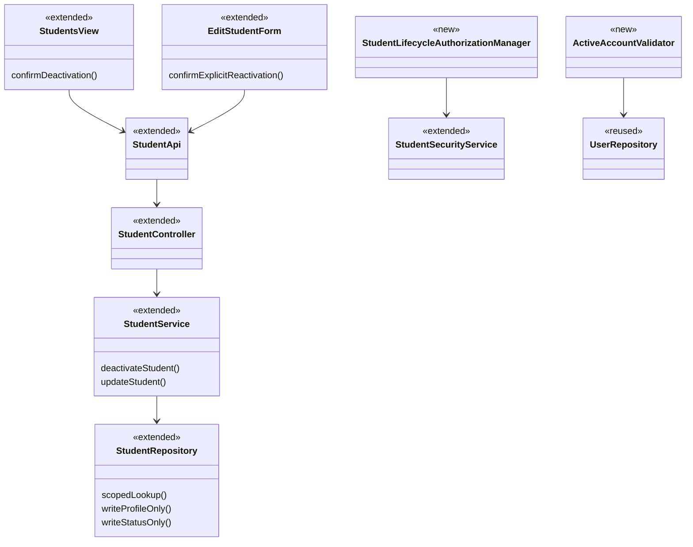
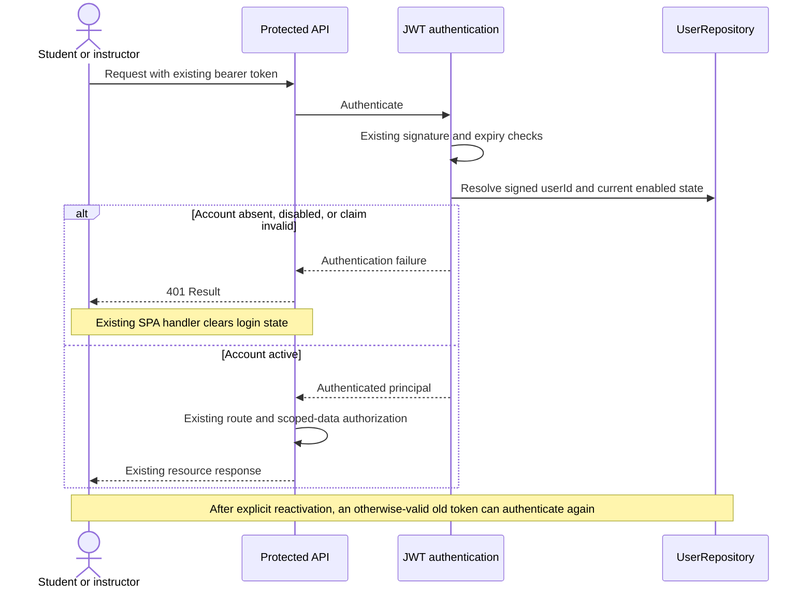
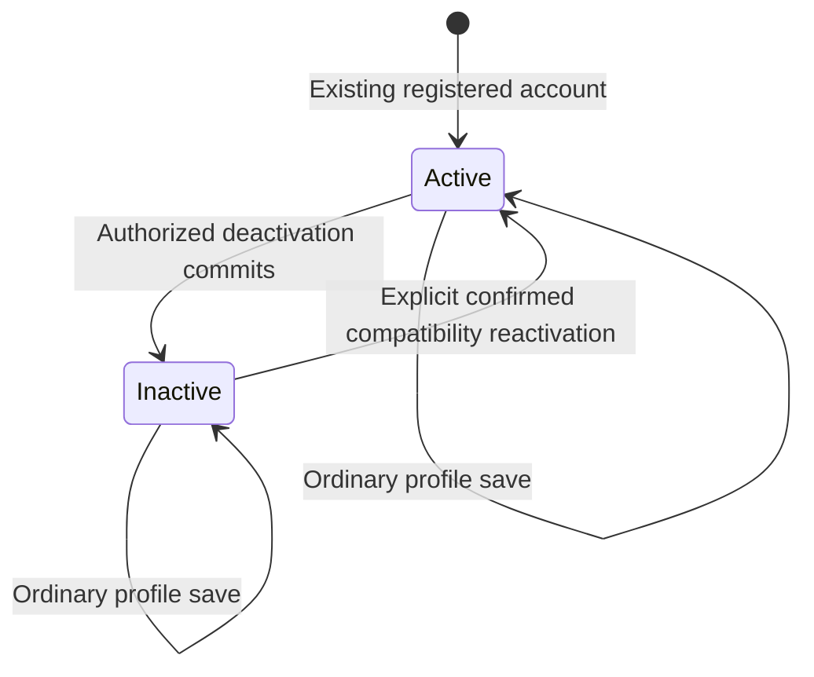

# Student Design

> Realizes: [UC-STU-deactivate-student](../requirements/use-cases.md#uc-stu-deactivate-student-the-course-admininstructor-deactivates-a-student)
> Depends on FRs: FR-SEC-authentication, FR-SEC-authorization, FR-SEC-deny-unauthorized, FR-SEC-active-account ([SRS](../requirements/software-requirements-specification.md#security-and-authorization-requirements))
> Supporting change: [UC-EVA-submit-evaluation](../requirements/use-cases.md#uc-eva-submit-evaluation-the-student-submits-a-peer-evaluation-for-the-previous-week); compatibility only for UC-STU-reactivate-student.
> Review state: shape accepted by the developer; design PR review and merge pending. No implementation is claimed.

## Overview

Extend the existing student vertical slice inside the [platform containers](architectural-design.md#containers), following [Architectural conventions](architectural-design.md#architectural-conventions). Requirements remain in the linked use cases and [business rules](../requirements/business-rules.md). The deactivation operation and profile operation have disjoint persistence write sets. Shared JWT validation enforces account status across performance tracking and RAM. Reactivation remains on the existing update endpoint as compatibility maintenance; this design does not complete its separate use case or add its notification workflow.

## Components & classes

Paths below are relative to the repository root. New paths are proposed implementation destinations, not existing artifacts.

| Component | Reuse / change | Responsibility and file |
|---|---|---|
| Student Management | Extend [Students.vue](../../frontend/src/pages/students/Students.vue) | Deactivate action, student identity/details, warning, confirmation, pending state, refresh after success |
| Profile form | Extend [EditStudentForm.vue](../../frontend/src/pages/students/EditStudentForm.vue) | Read-only status; separate confirmed Reactivate account control for inactive students; ordinary save never sends reactivation intent |
| Student API | Extend [index.ts](../../frontend/src/apis/student/index.ts), [types.ts](../../frontend/src/apis/student/types.ts) | Dedicated deactivate call; explicit optional reactivation parameter on existing update call |
| Student controller / service | Extend [StudentController.java](../../backend/src/main/java/team/projectpulse/student/StudentController.java), [StudentService.java](../../backend/src/main/java/team/projectpulse/student/StudentService.java) | Deactivate endpoint; transaction boundaries; profile and compatibility reactivation behavior |
| Student persistence | Extend [StudentRepository.java](../../backend/src/main/java/team/projectpulse/student/StudentRepository.java) | Caller-scoped lookup; targeted status and profile writes; refresh DTO from current state |
| Lifecycle permission | Extend [StudentSecurityService.java](../../backend/src/main/java/team/projectpulse/student/StudentSecurityService.java); new `backend/src/main/java/team/projectpulse/security/authorizationmanagers/StudentLifecycleAuthorizationManager.java` | Course ownership or assigned course-section instructor, with explicit instructor role; fail closed |
| JWT account check | New `backend/src/main/java/team/projectpulse/security/ActiveAccountValidator.java`; extend [SecurityConfiguration.java](../../backend/src/main/java/team/projectpulse/security/SecurityConfiguration.java) | Compose current-account validation with existing JWT validation; register deactivation rule and intent-aware existing PUT rule |
| Shared identity | Reuse [UserRepository.java](../../backend/src/main/java/team/projectpulse/user/UserRepository.java), [MyUserPrincipal.java](../../backend/src/main/java/team/projectpulse/user/MyUserPrincipal.java) | Current enabled-state lookup for students and instructors; existing login enabled check |
| Evaluation submission | Extend [EvaluationService.java](../../backend/src/main/java/team/projectpulse/evaluation/EvaluationService.java), [SubmitTeamsEvaluations.vue](../../frontend/src/pages/evaluations/SubmitTeamsEvaluations.vue) | Backend recipient-active check only on creation; filter new recipients while retaining existing evaluation editing |
| Infrastructure | Reuse [request.ts](../../frontend/src/utils/request.ts), [SubmissionStatusService.java](../../backend/src/main/java/team/projectpulse/notification/SubmissionStatusService.java) | Existing error/logout handling and active-only submission obligations |



## Sequence

### Deactivation

```mermaid
sequenceDiagram
    actor Operator as Course admin / assigned instructor
    participant UI as Student Management
    participant API as Student API and route guard
    participant Service as StudentService
    participant DB as StudentRepository
    Operator->>UI: Steps 1-3: view details and choose Deactivate
    UI->>API: Step 2: GET student details (existing view flow)
    API-->>UI: Student identity, status, enrollment and team
    UI-->>Operator: Step 4: consequences, Cancel and Deactivate student
    alt Extension 5a: cancel
        Operator->>UI: Cancel
        Note over UI,DB: No mutation request
    else Step 5: confirm
        Operator->>UI: Confirm
        UI->>API: POST /students/{studentId}/deactivate
        API->>API: Authenticate and check lifecycle permission
        alt Extension 1a or 3a: refused
            API-->>UI: 401 or 403 Result, no changes
        else Authorized
            API->>Service: Step 6: deactivate
            Service->>DB: Resolve target inside caller's permitted scope
            alt Extension 6b: target disappeared
                Service-->>API: Not found
                API-->>UI: 404 Result
            else Existing target, active or already inactive (6a)
                Service->>DB: Write enabled=false only, in transaction
                DB-->>Service: Current persisted student
                Service-->>API: Student DTO
                API-->>UI: 200 Result
                UI-->>Operator: Step 6: refresh status and show success
            end
        end
    end
    Note over UI,DB: Extension 6c: rollback failed writes; lost response permits reload or idempotent retry
```

The warning names the student and explains the consequences cited by the UC. Confirmation is disabled while pending; no optimistic status change or success toast precedes a successful response. Use accessible labels, focus handling and keyboard-operable controls. Existing shared 401/403/404 routing remains in use. Network/server failures retain a retry path; a lost response is an unknown outcome, not evidence of rollback.

### Existing-token refusal and restoration compatibility



### Profile save and explicit reactivation compatibility

```mermaid
sequenceDiagram
    actor Operator
    participant UI as EditStudentForm
    participant API as Existing student PUT
    participant Service as StudentService
    participant DB as StudentRepository
    alt Ordinary profile save
        Operator->>UI: Confirm profile changes
        UI->>API: PUT /students/{id} without reactivate=true
        API->>Service: Existing profile permission, validated DTO
        Service->>DB: Update profile columns only
    else Separate Reactivate account control
        Operator->>UI: Select control, then confirm restoration
        UI->>API: PUT /students/{id}?reactivate=true with current profile DTO
        API->>Service: Lifecycle permission for explicit restoration
        Service->>DB: Profile columns and explicit enabled=true, one transaction
    end
    Service-->>API: Current Student DTO
    API-->>UI: Result
    Note over API,DB: Unauthorized intent refuses the whole transaction; submitted enabled never controls status
```

## API contract

Paths are relative to `/api/v1`. Success and failure use the existing `Result` envelope and status mapping. No new scheduled job is introduced.

| Endpoint | Caller | Request | Success | Errors, by flow |
|---|---|---|---|---|
| New `POST /students/{studentId}/deactivate` | Target course owner or assigned course-section instructor | Path ID; no body | 200, current Student DTO with inactive status; same result for 6a | 1a: 401; 3a: 403, including unresolved/malformed target at guard; 6b: 404 after authorization; 6c: server failure or transport error, safe retry |
| Changed `GET /students/{studentId}` | Existing self/assigned-instructor viewers plus target course owner | Path ID | Existing Student DTO for confirmation/details | Existing 401/403 refusals; absent target fails closed at guard |
| Changed `PUT /students/{studentId}` | Existing profile authorization for ordinary save; lifecycle authorization for explicit restoration | Existing validated profile DTO; optional query `reactivate`, default false | 200 current Student DTO; absent/false instruction never alters status, regardless of body `enabled` | Existing validation errors 400; unauthenticated/inactive caller 401; explicit unauthorized intent 403 with no profile changes; post-guard disappearance 404; transaction failure rolls back |
| Changed `POST /evaluations` | Existing authorized active student | Existing evaluation DTO | Existing success for active recipient | UC-EVA-submit-evaluation 5a: 400 / INVALID_ARGUMENT with inactive-recipient message; all existing refusals retained |
| Existing `PUT /evaluations/{evaluationId}` | Existing authorized evaluator | Existing update DTO | Existing behavior; inactive recipient alone does not block edits to an existing evaluation | Existing window, validation and ownership errors unchanged |
| Existing `GET /students/teams/{teamId}` | Existing team access | Team ID | Full roster including inactive accounts | Existing errors unchanged; evaluation-entry UI filters new choices locally |

All protected bearer requests additionally honor FR-SEC-active-account; basic login retains its enabled-account check. `reactivate=true` is sent only by the separately confirmed control, never derived from the DTO or a stale status switch. Already-active restoration succeeds. An invalid reactivation parameter returns 400. No new reactivation endpoint is introduced.

## Key decisions

| Decision | Chosen approach | Rejected alternative and reason |
|---|---|---|
| Mutation boundary | Dedicated deactivate operation, write `enabled` only | Full-profile deactivation payload could overwrite unrelated fields |
| Persistence safety | Explicit column-limited writes for profile and status; clear/refresh affected managed state before returning DTO | Merely removing a setter does not guarantee ORM updates cannot write stale status during overlapping transactions |
| Permission | Instructor role plus target-course ownership or assigned course-section membership; route guard and caller-scoped repository query using `UserUtils` | Global admin role, caller-chosen body scope, or default course-section preference is not authority over the target |
| Compatibility | Existing PUT accepts explicit restoration intent, separately confirmed; ordinary DTO status ignored | Removing restoration breaks existing functionality; retaining an ordinary status switch risks accidental restoration; dedicated reactivation endpoint expands the assignment |
| Live account validation | Central JWT validator using signed userId and current persisted state, for students and instructors | UI-only logout, token claims alone, waiting for expiry, or per-controller checks leave valid-token access paths open |
| Validation composition | Add account check to existing JWT validators; reject missing/malformed userId, absent user or inactive account; DB outage never permits access | Replacing default validation could bypass expiry; caching enabled status creates an unapproved access-delay window |
| Token lifecycle | No blocklist/version; current active state determines acceptance after signature/expiry checks | Permanent old-token revocation requires extra state and conflicts with the approved restoration policy |
| Evaluation scope | Filter only new-recipient choices; reject inactive recipient at creation; keep existing evaluation edit path | Filtering every roster/report or blocking existing edits changes history access and approved window rules |
| Retry | Repeated inactive result succeeds after permission checks | A conflict for already inactive targets makes safe retries needlessly fail |

For scoped persistence, resolve using caller ID from `UserUtils` and the target's course owner/course-section instructor relationship, not the instructor's selected defaults. The existing PUT route selects lifecycle authorization when `reactivate=true`, and retains its existing profile guard otherwise; this admits a target course owner even when she is not separately listed as a course-section instructor. The existing student-details GET guard must also admit the target course owner for UC step 2, retaining existing self/assigned-instructor access; its service lookup enforces the matching caller scope. Both the route and service parse the same explicit instruction, and malformed input is rejected without mutation. The guard returns false rather than throwing. The repository predicate repeats that relationship for the service lookup; missing post-guard targets raise the existing not-found exception. Status/profile updates operate on that resolved target within the transaction. No client role or UI visibility check replaces either backend enforcement point.

## Data model

No schema delta: reuse `PeerEvaluationUser.enabled` and existing associations. See the [SRS Business Domain Model](../requirements/software-requirements-specification.md#business-domain-model) and [platform aggregate model](architectural-design.md#domain--aggregate-model). No ER diagram is needed for unchanged tables. No deletion, membership reassignment, score rewrite, token-version column or Flyway migration is planned.



## Reuse & cross-cutting

Use the shared Axios client, `Result`/global error mapping, JWT machinery, `UserUtils`, service transactions, existing DTO converters and active-only submission-owed logic. Add no new Pinia store, email workflow, lock subsystem or notification. Preserve the full team roster for other callers. Existing evaluations loaded into the submission editor must remain editable under their prior rules even when their recipient is inactive; filtering applies only when constructing new candidates. A form loaded before deactivation is backed by the creation-time server check.

The approved platform delta is documented under [Authentication](architectural-design.md#authentication): current-account validation is a designed change, not deployed behavior. It covers both capability areas and both account types. Account checks use persisted state without an enabled-status cache. Requests authenticated after the deactivation commit are denied; requests already authenticated may complete. No push disconnect, removal of browser-cached content, or transaction-level cancellation is promised.

## Tests

Rows are the implementation acceptance list, not claims that tests exist or pass. Unit tests live in the owning slice; integration tests use the existing shared MySQL/Mailpit setup. Frontend E2E tests use the existing Cypress setup. Each automated test identifies the UC/extension or rule it verifies.

| Row / use case, flow | Level | Asserts |
|---|---|---|
| T-main: STU steps 1-7, course admin | Integration + frontend E2E | Target course owner can deactivate even without separate course-section instructor membership; details/warning/confirmation precede mutation; returned and displayed status inactive |
| T-instructor: STU steps 1-7 | Integration | Assigned instructor succeeds; selected default course section does not grant or remove target permission |
| T-retain: STU POST-2 | Integration | Enrollment, team, activities, evaluations by/about target, historical scores and representative RAM authorship/content remain unchanged and readable by authorized users |
| T-teamless: STU Associated Information | Integration | Teamless target deactivates without error |
| T-auth: STU 1a | Integration | Anonymous caller and disabled caller (student and instructor) refused without mutation; disabled basic credentials obtain no token |
| T-deny: STU 3a | Integration | Student self, another student, unassigned instructor and unrelated course admin refused; nonexistent/malformed IDs fail closed at guard |
| T-cancel: STU 5a | Frontend E2E | Cancel sends no mutation; confirmation controls keyboard accessible; duplicate clicks while pending do not duplicate requests |
| T-repeat: STU 6a | Unit + integration | Repeat, including retry after success, returns inactive state without changing any other fields |
| T-disappear: STU 6b | Unit/service + integration where practical | Post-guard disappearance maps to 404; no writes |
| T-failure: STU 6c | Integration + frontend E2E | Persistence failure rolls back; error/lost response produces no false success; reload/retry reconciles committed outcome |
| T-profile: BR-student-lifecycle compatibility | Integration | Absent/false instruction ignores submitted enabled for active and inactive targets; stale profile cannot restore account status |
| T-overlap: persistence boundary | Integration with independent transactions | Overlapping profile and status updates preserve both committed profile changes and intended inactive status; no stale managed-state DTO |
| T-restore: compatibility only | Integration + frontend E2E | Separate confirmed intent restores for authorized owner/assigned instructor; ordinary save omits it; already active succeeds; unauthorized intent changes nothing; bad parameter returns 400 |
| T-token: FR-SEC-active-account | Integration using genuinely issued JWT | Token succeeds before deactivation, fails afterward on protected reads/writes including activity, evaluation and RAM paths; instructor token also rejected while inactive; otherwise-valid old token works after restoration |
| T-jwt: shared auth regression | Unit + real-token integration | Active accounts still work; invalid signature, expiry, malformed/missing userId and deleted account refused; unavailable account store never grants access; defaults remain composed |
| T-recipient: EVA 5a / BR-evaluation-active-recipient | Unit + integration + frontend E2E | New inactive recipient absent from choices; direct/stale-form create returns 400 without writes; active-recipient create still works |
| T-edit: EVA existing edit rules | Integration + frontend E2E | Existing evaluation about inactive target remains visible/editable in open window, and rejected when closed; historical scores unchanged by deactivation itself |
| T-reminder: BR-submission-owed | Integration | Inactive student owes nothing and is not a required recipient; remaining active teammates retain correct obligations |

Run targeted checks per implementation commit, then required complete backend/frontend checks before the build PR. Record manual main-flow evidence and confirmation-dialog screenshot for that PR. Do not mark this design's test list Verified before execution.

## Open questions / risks

- No unresolved product decision remains from the approved Phase 2 discussion. A fresh-session questions test and independent design PR review are still required.
- Current code still has generic status mutation and no live JWT account check; this document specifies future changes. The reactivation UC remains In progress and its notification remains outside this assignment.
- A peer-evaluation request already authenticated before deactivation may finish. Creation checks current recipient state when validated; no serializable cross-request ordering is promised. The approved cutoff does not cancel in-flight work.
- Status-only restoration permits old unexpired tokens again. This is intentional; the existing SPA may already have discarded its token after a 401, requiring that browser to log in again.
- Shared validator wiring must preserve Spring's existing validation/error mapping. Account lookup must not depend on an already-established `SecurityContext`, because validation precedes it.
- The platform authentication documentation change was explicitly approved. No context/container, deployment or RAM component boundary changes are required.
