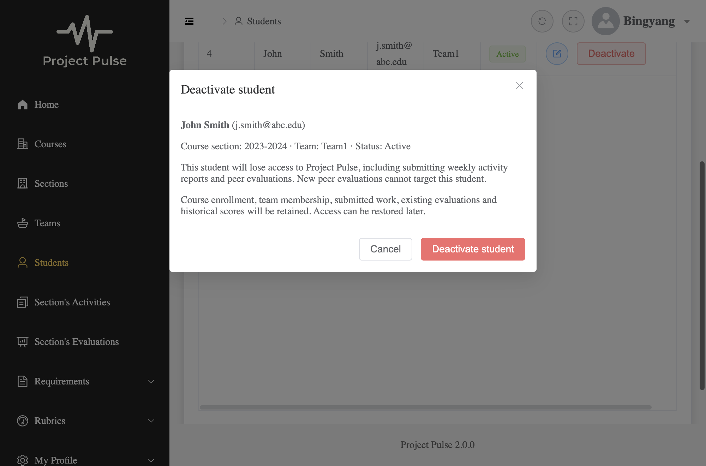

# Student deactivation build evidence

This is verification evidence for `UC-STU-deactivate-student`, not a replacement requirements specification. The contract is [the use case](../requirements/use-cases.md#uc-stu-deactivate-student-the-course-admininstructor-deactivates-a-student) and [Student Design](../design/stu.md). Run date: November 4, 2026 (America/Chicago).

## Commits and scope

- `4ac254a`: shared trunk; the developer reviewed and explained profile/status isolation and evaluator locking before approving continuation.
- `dc56f98`: security rules, strict restoration-intent parsing and live-account JWT wiring, isolated in their own commit.
- `035f4f2`: controller flow and backend acceptance tests.
- `4dca3d3`: student management confirmation, failure/retry and explicit profile restoration.
- `5a5b9dc`: evaluation recipient filtering and independent outcome recovery.

No schema migration, unrelated TypeScript repair, new status store, notification redesign or completion of the standalone reactivation use case is included. The Maven wrapper's executable bit was corrected so the documented `./mvnw` command works. The confirmation receipt uses its endpoint's ISO week key instead of the old display-range argument.

## Initial build execution results

- Two parameterized HTTP profile cases also passed after explicitly asserting literal `reactivate=false` for active/inactive accounts; no production code changed after the complete build.
- Backend targeted runs passed: trunk classes, security wiring (32 tests), new controller acceptance (11 tests), and existing student/evaluation API regressions.
- Full backend: **496 tests passed, zero failures/errors/skips; jar packaging succeeded** (`JAVA_HOME=<Java 21> ./mvnw clean package`, from `backend/`). Cleaning removes pre-existing duplicate compiled main-class artifacts; it does not change source or schema.
- Feature Cypress specs: **12 passed**, no failures/skips. The complete suite also executed: **23 passed, 4 failed, 4 skipped** across six specs. The two feature specs and existing reminders spec passed.
- `npm run cy:open` launched the interactive runner; automated evidence comes from `cypress run` in Electron 118, Cypress 13.17.0. `ELECTRON_RUN_AS_NODE` was removed from the command environment so Electron could launch normally.
- `npm run build`: **failed with 18 pre-existing TypeScript errors**. The diagnostics exactly match a separate source copy of trunk `4ac254a` using the same installed dependencies. No feature file has a type diagnostic, and no unrelated source file was modified to suppress the failure.
- `npm run build-only`: **passed**, producing the Vite production bundle. This does not replace the failed type-checking build.
- Required docs checks: no mechanical edits needed in the five requirements sources; IDs, links, UC/FR rows, feature/BO/metric/risk mappings and scenario bindings resolve. Existing unrelated findings remain: 25 active use cases with empty extension lists, a duplicate traceability heading and 12 quality-measurability heuristic flags. Judgment review covered the changed lifecycle/creation/recovery design and its immediate requirements.

### Known baseline frontend failures

The 18 unchanged diagnostics occur in `SearchPeriod.vue` (2), `SearchWeek.vue` (4), `TopNavigationBar.vue` (2), `SectionsActivities.vue` (1), `StudentActivities.vue` (2), `StudentEvaluations.vue` (1), `RamDocumentEditor.vue` (2), `Teams.vue` (2) and `UserRegistration.vue` (2). They concern optional indexed values, an untyped injected value, chart option/data types, a TipTap API argument and an undeclared drag flag. The developer explicitly requested leaving these files untouched.

The complete Cypress run fails unchanged `login.spec.cy.js` at the expected `h1` heading and successful `john` login. `peerevalutions.spec.cy.js` and `weeklyactivities.spec.cy.js` each fail their `john` login setup and skip their remaining two tests. The repository seeds the student username `j.smith@abc.edu`; these specs use stale credentials. These failures are recorded, not counted as passes or repaired in this assignment.

## Design test matrix

All named feature tests below passed; grouped rows combine service/HTTP/browser evidence rather than claiming a browser test proves backend authorization. Java paths are under `backend/src/test/java/team/projectpulse/`; browser paths are under `frontend/cypress/e2e/`.

| Design row | Concrete tests / evidence | Limits |
|---|---|---|
| T-main | `StudentDeactivationIntegrationTest.courseOwnerWithoutSectionAssignmentCanReadDeactivateRepeatAndRestore`; `StudentLifecyclePersistenceIntegrationTest.inheritedInstructorOwnerCanDeactivateTeamlessStudentAndRepeat`; student browser confirmation and live-app cases | The inherited `ROLE_admin`-only case is service-level; the HTTP course-owner case uses a genuinely issued admin token |
| T-instructor | `StudentDeactivationIntegrationTest.assignedInstructorPermissionDoesNotDependOnSelectedDefaults` | Selected preference is cleared without losing target assignment |
| T-retain | `StudentDeactivationIntegrationTest.deactivationPreservesEnrollmentMembershipHistoricalRecordsAndAuthoredContent` | Compares complete stored rows, associations, scores, a representative author ID and content; authorized RAM/history reads remain available |
| T-teamless | `StudentDeactivationIntegrationTest.teamlessStudentCanBeDeactivatedAndInactiveStudentOwesNothing`; persistence teamless test | No team required |
| T-auth | `StudentLifecycleSecurityIntegrationTest.issuedTokenObeysCommittedStateForBothAccountTypesAndWorksAgainAfterRestore`; controller anonymous refusal | Independent committed account-state changes, both account types; disabled Basic login refused |
| T-deny | `StudentDeactivationIntegrationTest.refusalsNeverMutateAndDoNotRevealTargetExistence`; security `selfCannotRestoreAndUnresolvedLifecycleIdsFailClosed`; `StudentSecurityServiceTest` | Self, another student, unrelated course admin, unassigned instructor and unresolved/malformed targets |
| T-cancel | Student browser `shows identity, scope and consequences...`; `disables duplicate confirmation...` | Keyboard Enter on focused cancel/confirm; pending duplicate click sends one request |
| T-repeat | Controller course-owner repeat; `StudentServiceTest.testDeactivateRepeatStillChecksScopeAndWritesOnlyStatus`; browser failed-request retry | Permission checked before repeated success |
| T-disappear | Controller `postGuardDisappearanceUses404AndPersistenceFailureDoesNotSucceed`; persistence `scopePredicateRefusesMutationAfterAssignmentLost`; unit scope-loss cases | HTTP disappearance is injected at post-guard lookup; actual assignment removal checks service and mutation predicates |
| T-failure | Controller `failedDeactivationRollsBack`; restoration independent rollback; browser server-failure and lost-response cases | Lost acknowledgement is simulated with a response delayed past the client's timeout; reload reconciles inactive state |
| T-profile | Controller `ordinaryProfileSaveIgnoresBodyStatus`; persistence `ordinaryProfileSaveIgnoresBodyStatusAndPrivilegeFields`; student ordinary-save browser case | Both active and inactive accounts, with absent and explicit `reactivate=false` instructions; untrusted status/privilege fields never control lifecycle |
| T-overlap | `StudentLifecyclePersistenceIntegrationTest.staleManagedProfileCannotUndoCommittedDeactivation` | Independent explicitly committed transactions; returned status is current |
| T-restore | Controller owner restore, already-active restore and `validationAndStatusWriteFailureRollBackWholeRestoration`; persistence atomic/unauthorized test; security malformed/duplicate-intent cases; browser draft/cancel/confirmed-restore case | No separate reactivation notification workflow |
| T-token | Security committed-state test plus live browser `deactivates through the real dialog, rejects an issued token after commit, and restores the fixture` | Covers protected activity write, evaluation/RAM reads and old-token acceptance after restored state; no promise to cancel in-flight work |
| T-jwt | `ActiveAccountValidatorTest`; `CustomBearerTokenAuthenticationEntryPointTest`; security signed-identity/default-validation/outage tests; browser 503-vs-401 case | Missing/null/string/fraction/boolean/collection/zero/negative/overflow claims; malformed IDs cause no lookup; outage runs no protected student handler |
| T-recipient | `EvaluationServiceTest.testInactiveRecipientCreationRejectedWithoutSaving`; controller `staleCreationRefusedButSavedInactiveRecipientEvaluationRemainsEditable`; evaluation browser active-new-recipient cases | Shared full team roster is preserved |
| T-edit | Same controller compatibility test; evaluation browser saved-inactive-recipient case; existing closed-window API regressions | Stored evaluator/recipient/week immutable despite conflicting payload; historical scores are compared separately before authorized editing |
| T-order | Persistence `lifecycleWritersSerializeAndLastSuccessfulCommitWins` in both parameterized orders | Second writer waits through the first commit; final status follows the later lifecycle operation |
| T-refresh | Student browser `disables duplicate confirmation and retains acknowledged inactive status when refresh fails` | Separate refresh warning and one mutation |
| T-recover | Evaluation browser `reconciles mixed saved/rejected/unknown rows...` and `retains drafts and blocks blind replay...`; creation concurrency tests | Known saved IDs retried with PUT, new active drafts with POST; only never-submitted/definitively rejected inactive rows removed with explanation; unknown rows retained until positive outcome; no overall email on failure |
| T-create-overlap | `EvaluationCreationConcurrencyIntegrationTest.overlappingCreateWaitsForCommitThenRefusesDuplicateDespiteOldSnapshot` and `overlappingCreateSucceedsAfterFirstWriterRollsBack` | Real MySQL repeatable-read snapshot; explicit fixture cleanup, no `@DirtiesContext` |
| T-init-recovery | Cypress `retries incomplete section initialization...` and `retries incomplete rubric initialization...` | Required dependencies and valid criteria load before reconciliation and submission; initial failures retain the disabled state until recovery succeeds |
| T-late-commit | MySQL `timedOutOriginalCanCommitAfterInactiveRecipientAndEmptyRecoveryRead`; Cypress `retains an inactive unresolved draft after timeout and empty read, then attaches the late commit ID` | Real database late commit and separate browser timeout/retention assertions; empty read is not proof of failure, and the saved ID selects PUT |
| T-reminder | Controller teamless/owed test; `SubmissionStatusServiceTest` active-member obligation tests and existing notification integration tests | Inactive students owe nothing and are excluded from required recipient sets |

No target deactivation extension is intentionally left untested. The whole-product baseline frontend checks above remain red independently of this feature's passing acceptance tests. The supporting EVA 5a flow is covered; this does not claim a fresh browser audit of the complete pre-existing EVA use case.

## Running-app evidence

The live Cypress case used the actual backend and UI, deactivated John through the confirmation dialog, observed the inactive roster state, and checked an already-issued student token returned HTTP 401 / `flag=false` / `code=401` after commit. It restored the seeded account through an explicitly authorized restoration request in cleanup. Other browser cases stub individual failures and independent row outcomes.

MySQL and Mailpit used isolated ports 3307, 1026 and 8026 because the standard ports were occupied; backend configuration was supplied only as launch arguments. Existing services were not stopped or repurposed.

## Deliberate code-break check

The test trusted least before verification was the repeatable-read concurrency test. In an isolated archived source copy, remove the single `@Lock(LockModeType.PESSIMISTIC_WRITE)` annotation from `PeerEvaluationRepository.findExistingForCreation`, leaving evaluator-row serialization intact. Run only `EvaluationCreationConcurrencyIntegrationTest#overlappingCreateWaitsForCommitThenRefusesDuplicateDespiteOldSnapshot`.

The mutated test went **red**: the second creator saw its old empty snapshot, inserted a duplicate and raised no exception (`Expecting actual not to be null`). The branch's unchanged locking/current-read implementation passes both concurrency tests. The mutation never touched the working tree or running app classes; Git metadata generation was skipped only in the temporary copy.

## Tests retained, rewritten and review limits

Each design-matrix row names the retained tests and their requirement oracle. Existing `StudentServiceTest.testInstructorUpdatesStudent` was replaced because its expected generic `enabled` mutation contradicts `BR-student-lifecycle`; the replacement tests both status states through scoped, profile-only writes. The self-profile and scoped-read unit tests were updated to the new repository boundary. Evaluation success/duplicate unit tests were updated for evaluator locking and current-read duplication. No unrelated tests were removed or disabled.

Agent review triage: shared lifecycle/account/creation code and the isolated security rules reviewed directly; controller and frontend leaves checked against their acceptance tests and error states. The developer subsequently supplied three medium-severity findings from an independent fresh-context review; the findings, fixes and follow-up results appear below. Independent re-review and the developer's own labeled diff comment are not claimed by this implementation session.

## Individual retained test oracles

Each line below is one new or revised test method (parameterized variants share the method and oracle). Unchanged whole-product tests are represented by the complete-suite result, not relisted as assignment additions.

| Test | Oracle source |
|---|---|
| `ActiveAccountValidatorTest.malformedIdentityDoesNotLookupAccount` | FR-SEC-active-account; T-jwt |
| `ActiveAccountValidatorTest.expiredTokenKeepsDefaultValidationAndDoesNotLookupAccount` | FR-SEC-active-account; T-jwt |
| `ActiveAccountValidatorTest.explicitNullIdentityDoesNotLookupAccount` | FR-SEC-active-account; T-jwt |
| `ActiveAccountValidatorTest.accountStateIsReadAgainAfterDeactivationAndRestoration` | FR-SEC-active-account; T-jwt |
| `ActiveAccountValidatorTest.absentAccountRefused` | FR-SEC-active-account; T-jwt |
| `ActiveAccountValidatorTest.outageProducesDistinctGenericError` | FR-SEC-active-account; T-jwt |
| `CustomBearerTokenAuthenticationEntryPointTest.accountStoreFailureMapsToRetryableInfrastructureException` | FR-SEC-authentication/active-account; T-jwt |
| `CustomBearerTokenAuthenticationEntryPointTest.invalidTokenKeepsExistingAuthenticationErrorMapping` | FR-SEC-authentication/active-account; T-jwt |
| `StudentLifecycleSecurityIntegrationTest.signedMalformedIdentitiesFailBeforeLookupOrHandler` | FR-SEC-authentication/authorization/active-account; T-auth/T-deny/T-token/T-jwt/T-restore |
| `StudentLifecycleSecurityIntegrationTest.expiryAndBadSignatureKeepDefaultValidation` | FR-SEC-authentication/authorization/active-account; T-auth/T-deny/T-token/T-jwt/T-restore |
| `StudentLifecycleSecurityIntegrationTest.unavailableAccountStoreReturnsGeneric503WithoutProtectedLogic` | FR-SEC-authentication/authorization/active-account; T-auth/T-deny/T-token/T-jwt/T-restore |
| `StudentLifecycleSecurityIntegrationTest.malformedIntentIs400AfterAuthentication` | FR-SEC-authentication/authorization/active-account; T-auth/T-deny/T-token/T-jwt/T-restore |
| `StudentLifecycleSecurityIntegrationTest.duplicatesAreInvalidAndAnonymousAuthenticationPrecedesParsing` | FR-SEC-authentication/authorization/active-account; T-auth/T-deny/T-token/T-jwt/T-restore |
| `StudentLifecycleSecurityIntegrationTest.selfCannotRestoreAndUnresolvedLifecycleIdsFailClosed` | FR-SEC-authentication/authorization/active-account; T-auth/T-deny/T-token/T-jwt/T-restore |
| `StudentLifecycleSecurityIntegrationTest.issuedTokenObeysCommittedStateForBothAccountTypesAndWorksAgainAfterRestore` | FR-SEC-authentication/authorization/active-account; T-auth/T-deny/T-token/T-jwt/T-restore |
| `StudentSecurityServiceTest.studentCannotManageEvenOwnLifecycle` | BR-student-lifecycle/section-scoped-access; T-deny |
| `StudentSecurityServiceTest.unresolvedIdIsDeniedWithoutLookup` | BR-student-lifecycle/section-scoped-access; T-deny |
| `StudentSecurityServiceTest.lifecycleLookupUsesTargetScopeAndNeverSelfPermission` | BR-student-lifecycle/section-scoped-access; T-deny |
| `StudentSecurityServiceTest.persistenceFailureDeniesBothNewGuards` | BR-student-lifecycle/section-scoped-access; T-deny |
| `StudentLifecyclePersistenceIntegrationTest.inheritedInstructorOwnerCanDeactivateTeamlessStudentAndRepeat` | BR-student-lifecycle; T-profile/T-overlap/T-order/T-restore/T-disappear/T-teamless |
| `StudentLifecyclePersistenceIntegrationTest.ordinaryProfileSaveIgnoresBodyStatusAndPrivilegeFields` | BR-student-lifecycle; T-profile/T-overlap/T-order/T-restore/T-disappear/T-teamless |
| `StudentLifecyclePersistenceIntegrationTest.restorationIsAtomicAndUnauthorizedRestorationCannotSaveProfile` | BR-student-lifecycle; T-profile/T-overlap/T-order/T-restore/T-disappear/T-teamless |
| `StudentLifecyclePersistenceIntegrationTest.rollbackLeavesStatusAndProfileUnchanged` | BR-student-lifecycle; T-profile/T-overlap/T-order/T-restore/T-disappear/T-teamless |
| `StudentLifecyclePersistenceIntegrationTest.scopePredicateRefusesMutationAfterAssignmentLost` | BR-student-lifecycle; T-profile/T-overlap/T-order/T-restore/T-disappear/T-teamless |
| `StudentLifecyclePersistenceIntegrationTest.lifecycleWritersSerializeAndLastSuccessfulCommitWins` | BR-student-lifecycle; T-profile/T-overlap/T-order/T-restore/T-disappear/T-teamless |
| `StudentLifecyclePersistenceIntegrationTest.staleManagedProfileCannotUndoCommittedDeactivation` | BR-student-lifecycle; T-profile/T-overlap/T-order/T-restore/T-disappear/T-teamless |
| `StudentDeactivationIntegrationTest.courseOwnerWithoutSectionAssignmentCanReadDeactivateRepeatAndRestore` | UC-STU-deactivate-student main/1a/3a/6a/6b/6c; BR-student-lifecycle/evaluation-active-recipient; T-retain/T-reminder |
| `StudentDeactivationIntegrationTest.assignedInstructorPermissionDoesNotDependOnSelectedDefaults` | UC-STU-deactivate-student main/1a/3a/6a/6b/6c; BR-student-lifecycle/evaluation-active-recipient; T-retain/T-reminder |
| `StudentDeactivationIntegrationTest.refusalsNeverMutateAndDoNotRevealTargetExistence` | UC-STU-deactivate-student main/1a/3a/6a/6b/6c; BR-student-lifecycle/evaluation-active-recipient; T-retain/T-reminder |
| `StudentDeactivationIntegrationTest.ordinaryProfileSaveIgnoresBodyStatus` | UC-STU-deactivate-student main/1a/3a/6a/6b/6c; BR-student-lifecycle/evaluation-active-recipient; T-retain/T-reminder |
| `StudentDeactivationIntegrationTest.validationAndStatusWriteFailureRollBackWholeRestoration` | UC-STU-deactivate-student main/1a/3a/6a/6b/6c; BR-student-lifecycle/evaluation-active-recipient; T-retain/T-reminder |
| `StudentDeactivationIntegrationTest.postGuardDisappearanceUses404AndPersistenceFailureDoesNotSucceed` | UC-STU-deactivate-student main/1a/3a/6a/6b/6c; BR-student-lifecycle/evaluation-active-recipient; T-retain/T-reminder |
| `StudentDeactivationIntegrationTest.failedDeactivationRollsBack` | UC-STU-deactivate-student main/1a/3a/6a/6b/6c; BR-student-lifecycle/evaluation-active-recipient; T-retain/T-reminder |
| `StudentDeactivationIntegrationTest.deactivationPreservesEnrollmentMembershipHistoricalRecordsAndAuthoredContent` | UC-STU-deactivate-student main/1a/3a/6a/6b/6c; BR-student-lifecycle/evaluation-active-recipient; T-retain/T-reminder |
| `StudentDeactivationIntegrationTest.teamlessStudentCanBeDeactivatedAndInactiveStudentOwesNothing` | UC-STU-deactivate-student main/1a/3a/6a/6b/6c; BR-student-lifecycle/evaluation-active-recipient; T-retain/T-reminder |
| `StudentDeactivationIntegrationTest.staleCreationRefusedButSavedInactiveRecipientEvaluationRemainsEditable` | UC-STU-deactivate-student main/1a/3a/6a/6b/6c; BR-student-lifecycle/evaluation-active-recipient; T-retain/T-reminder |
| `EvaluationCreationConcurrencyIntegrationTest.overlappingCreateWaitsForCommitThenRefusesDuplicateDespiteOldSnapshot` | UC-EVA-submit-evaluation 5a; T-create-overlap |
| `EvaluationCreationConcurrencyIntegrationTest.overlappingCreateSucceedsAfterFirstWriterRollsBack` | UC-EVA-submit-evaluation 5a; T-create-overlap |
| `StudentServiceTest.testFindStudentById` | UC-STU-deactivate-student 6a/6b and BR-student-lifecycle; scoped-details design |
| `StudentServiceTest.testStudentUpdateOwnInfo` | UC-STU-deactivate-student 6a/6b and BR-student-lifecycle; scoped-details design |
| `StudentServiceTest.testDeactivateRepeatStillChecksScopeAndWritesOnlyStatus` | UC-STU-deactivate-student 6a/6b and BR-student-lifecycle; scoped-details design |
| `StudentServiceTest.testScopeLossAtMutationReturnsNotFound` | UC-STU-deactivate-student 6a/6b and BR-student-lifecycle; scoped-details design |
| `StudentServiceTest.testScopeLossBeforeLookupDoesNotWrite` | UC-STU-deactivate-student 6a/6b and BR-student-lifecycle; scoped-details design |
| `EvaluationServiceTest.testAddPeerEvaluationSuccess` | UC-EVA-submit-evaluation creation/5a; T-recipient/T-create-overlap |
| `EvaluationServiceTest.testAddPeerEvaluationDuplicatedEvaluation` | UC-EVA-submit-evaluation creation/5a; T-recipient/T-create-overlap |
| `EvaluationServiceTest.testInactiveRecipientCreationRejectedWithoutSaving` | UC-EVA-submit-evaluation creation/5a; T-recipient/T-create-overlap |
| student-deactivation.spec.cy.js: shows identity, scope and consequences before one confirmed request; keyboard cancel sends nothing (T-main/T-cancel) | UC-STU-deactivate-student main/5a/6a/6c/6d; T-profile/T-restore/T-jwt/T-token |
| student-deactivation.spec.cy.js: disables duplicate confirmation and retains acknowledged inactive status when refresh fails (6d) | UC-STU-deactivate-student main/5a/6a/6c/6d; T-profile/T-restore/T-jwt/T-token |
| student-deactivation.spec.cy.js: does not claim success for a server failure and permits a safe retry (6c/6a) | UC-STU-deactivate-student main/5a/6a/6c/6d; T-profile/T-restore/T-jwt/T-token |
| student-deactivation.spec.cy.js: offers reload after a lost response without claiming rollback or success (6c) | UC-STU-deactivate-student main/5a/6a/6c/6d; T-profile/T-restore/T-jwt/T-token |
| student-deactivation.spec.cy.js: keeps status read-only, preserves draft on cancelled restoration, and sends explicit confirmed intent (T-restore) | UC-STU-deactivate-student main/5a/6a/6c/6d; T-profile/T-restore/T-jwt/T-token |
| student-deactivation.spec.cy.js: ordinary saving omits restoration intent (T-profile) | UC-STU-deactivate-student main/5a/6a/6c/6d; T-profile/T-restore/T-jwt/T-token |
| student-deactivation.spec.cy.js: 503 preserves login state and allows retry, while 401 clears login (T-jwt) | UC-STU-deactivate-student main/5a/6a/6c/6d; T-profile/T-restore/T-jwt/T-token |
| student-deactivation.spec.cy.js: deactivates through the real dialog, rejects an issued token after commit, and restores the fixture | UC-STU-deactivate-student main/5a/6a/6c/6d; T-profile/T-restore/T-jwt/T-token |
| evaluation-deactivation-recovery.spec.cy.js: offers active new recipients and preserves saved inactive-recipient edits (T-recipient/T-edit) | UC-EVA-submit-evaluation 5a; T-recipient/T-edit/T-recover |
| evaluation-deactivation-recovery.spec.cy.js: never constructs a new inactive-recipient row (T-recipient) | UC-EVA-submit-evaluation 5a; T-recipient/T-edit/T-recover |
| evaluation-deactivation-recovery.spec.cy.js: reconciles mixed saved/rejected/unknown rows, retains active drafts and retries known saves with PUT (T-recover) | UC-EVA-submit-evaluation 5a; T-recipient/T-edit/T-recover |
| evaluation-deactivation-recovery.spec.cy.js: retains drafts and blocks blind replay when recovery reads fail (T-recover) | UC-EVA-submit-evaluation 5a; T-recipient/T-edit/T-recover |
| `EvaluationCreationConcurrencyIntegrationTest.timedOutOriginalCanCommitAfterInactiveRecipientAndEmptyRecoveryRead` | UC-EVA-submit-evaluation 5a; T-late-commit; review R3 |
| evaluation-deactivation-recovery.spec.cy.js: retries incomplete section initialization before enabling submission | T-init-recovery; review R2 |
| evaluation-deactivation-recovery.spec.cy.js: retries incomplete rubric initialization before enabling submission | T-init-recovery; review R2 |
| evaluation-deactivation-recovery.spec.cy.js: retains an inactive unresolved draft after timeout and empty read, then attaches the late commit ID | UC-EVA-submit-evaluation 5a; T-late-commit; review R3 |

## Independent review findings and fixes

The developer supplied these three medium-severity findings from the fresh-context review of PR #3. Each has a separate fix commit; these are implementation/test outcomes, not a claim that the independent reviewer has re-approved the changes.

| Finding | Fix commit and behavior | Regression evidence |
|---|---|---|
| R1: transaction-start infrastructure exceptions escape account validation | `914dbfe`: `ActiveAccountValidator` also maps `CannotCreateTransactionException`, `TransactionSystemException` and `TransactionTimedOutException` to its generic account-store failure; does not catch arbitrary runtime/programming errors | `ActiveAccountValidatorTest.outageProducesDistinctGenericError` and `StudentLifecycleSecurityIntegrationTest.unavailableAccountStoreReturnsGeneric503WithoutProtectedLogic`, each parameterized over DAO/create/system/timeout failures; exact envelope/message, no internal details, no protected student handler. Focused auth run: 34 passed |
| R2: recovery bypasses incomplete section/rubric initialization | `637ab59`: retry incomplete initialization before reconciliation; candidate construction and submission require successfully loaded criteria | Two Cypress cases, `retries incomplete section initialization...` and `retries incomplete rubric initialization...`, verify initial refusal, no premature reconciliation, disabled in-flight submission, then valid ratings and successful recovery/submission. Focused six-case run passed |
| R3: an empty recovery read drops an inactive unresolved draft before original commit | `e82da23`: distinguish definitive rejection from unknown outcomes; preserve unknown rows even for inactive recipients, keep Submit/confirmation blocked, and resolve only on a positive stored outcome | `EvaluationCreationConcurrencyIntegrationTest.timedOutOriginalCanCommitAfterInactiveRecipientAndEmptyRecoveryRead` and Cypress `retains an inactive unresolved draft after timeout and empty read, then attaches the late commit ID`; all three MySQL concurrency cases and seven recovery browser cases passed |

The MySQL regression pauses creation after validation and before its real JPA insert, times out the caller without cancelling the transaction, commits recipient deactivation, and reads no evaluation. Releasing the original then commits the stored evaluation. Its committed fixtures are explicitly cleaned up. The browser regression separately uses an actual Axios timeout and staged backend responses to assert draft fields remain, no blind replay/email occurs, and the saved ID later selects PUT. It does not claim Cypress mocks themselves prove a database commit.

Unknown outcomes have no time-based expiry. If the backend still provides no positive outcome, the row remains retained and submission remains blocked; absence from one read is not treated as proof of rollback. Definitive rejected inactive rows can still be removed with explanation. No new polling window, operation-status endpoint, token state, schema change or unrelated baseline repair was introduced.

### Follow-up verification

- Full backend after review fixes: **503 tests passed, zero failures/errors/skips; `./mvnw package` succeeded**.
- Full Cypress after review fixes: **26 passed, 4 failed, 4 skipped** across 34 cases; the 15 feature cases and 9 reminder cases pass, while only the unchanged login/menu baseline specs fail; all seven focused recovery cases already pass.
- Required frontend build still reports exactly the same **18 baseline diagnostics**, with no feature-file errors and no unrelated source modifications.
- Vite production bundle: **passed**.
- Design rows `T-jwt`, `T-recover`, `T-init-recovery` and `T-late-commit` and the affected UC/FR traceability cells now name the added cases. No deactivation extension was removed from the acceptance list.
